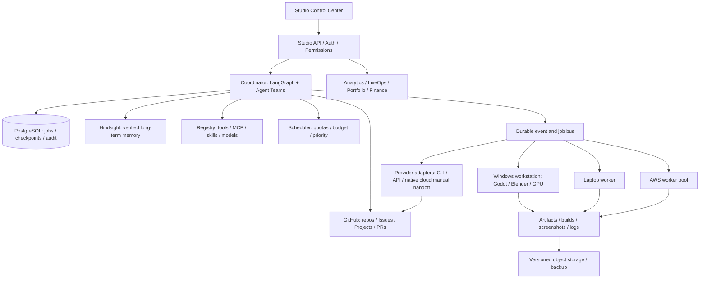

> **ARCHIVED EVIDENCE SOURCE (2026-11-14).** This is the pre-existing, owner-accepted consolidated architecture summary, **not** the original verbatim 142 Q&A transcript. Binding current decisions are GitHub Issues labeled `decision`; any later explicitly superseding decision wins. The self-hosted platform parts (coordinator, PostgreSQL execution, workers, Studio Control Center) were deferred by DEC-143 (#146) on 2026-11-17 and deferred for good by DEC-146 (#164) on 2026-11-19; the studio ships as a Claude Code and Codex plugin.

# GameDev AGI Studio — Technical Architecture & Implementation Specification

**Version:** 1.0 (architecture baseline)  
**Date:** 2026-11-14  
**Status:** Design baseline; integration feasibility to be verified  
**Language:** Russian  
**Purpose:** Implementation-ready reference for Claude Code, Codex and engineering agents.

> **Scope and provenance.** This document consolidates the design decisions and project context available in the conversation, including approvals through decision #142. It is not a verbatim transcript of every question #1–#142. Vendor-specific features, SDK versions, subscription entitlements and platform policies must be verified against current documentation and by integration smoke tests before implementation.

## 1. Mission and non-negotiable principles

Build a professional autonomous multi-project AI game studio that researches concepts, co-designs games with the owner, develops high-quality 2D/2.5D/3D games, tests on target devices, publishes through approved channels, and improves released games based on evidence.

Initial game targets: Godot 4.x; Playgama HTML5, compatible partner platforms including YouTube Playables where accepted; potential Android, iOS, Steam and standalone web releases. The architecture must permit online/multiplayer modes without forcing unused networking infrastructure into offline games.

**Non-negotiable rules:**
1. Quality gates are not lowered because of time, tokens, quotas or budget. Reduce concurrency or pause.
2. No fake tool execution, invented test result, silently substituted inferior tool, placeholder passed off as finished asset, or unverified release claim.
3. Approved game design, art direction, architectural contracts and publishing authority cannot be overridden by agents.
4. Agents should prevent defects through architecture-aware planning; automated checks are the last defense.
5. Every critical output is versioned, traceable, independently reviewed and reproducible where technically possible.
6. No assumption that a paid Claude/Codex chat subscription grants API credits or programmatic cloud-task creation.
7. Minimize needless ceremony: simple tasks use lightweight deterministic preflight; significant changes require deeper review.

## 2. System topology



**Control plane:** AWS-hosted coordinator, APIs, policy engine, scheduler, durable task state, notifications, registry.  
**Execution plane:** Windows PC, laptop, AWS workers, supported Claude/Codex environments.  
**Data plane:** GitHub for source, issues and decisions; PostgreSQL for operational state; Hindsight for retrievable memory; object storage for large artifacts and backup.

### 2.1 Ownership of truth

| Data | Authoritative source | Notes |
|---|---|---|
| Approved GDD, architecture, Art Bible, ADRs | Versioned project repository | Explicit approval status and revision |
| Tasks, dependencies, PRs, work logs | GitHub Issues/Projects/PRs | No competing duplicate task board |
| Execution state, leases, checkpoints, permissions audit | PostgreSQL | Recoverable and transactional |
| Reusable verified knowledge | Hindsight + provenance index | Cannot override approved documents |
| Models, tools, MCP, skills, compatibility | Versioned registry | Real availability tests |
| Builds, recordings, model outputs | Immutable object storage + manifests | Hashes, versions, retention |
| Revenue and cost | Imported source records + reconciled ledger | Distinguish actual, accrued, estimated |

## 3. Core services and boundaries

Recommended implementation: **modular monolith for the coordinator initially**, with explicit module boundaries and internal events. Extract services only when scaling, security, isolation or independent deployment justifies it. For the game client, modular Godot architecture; server microservices only when justified by online workloads.

- **Identity & Permission Service:** user, roles, agent scopes, Allow/Ask/Deny, expiry, emergency stop, audit.
- **Project Service:** project lifecycle, approvals, requirements revisions, platform targets.
- **Workflow Orchestrator:** LangGraph state machines, dependency DAG, retry and escalation.
- **Agent Runtime / Provider Adapters:** model routing, task envelopes, tool capabilities, result normalization.
- **Worker Manager:** registration, health, capabilities, lease, secure outbound transport, placement.
- **Tool & MCP Registry:** availability, location, permissions, version pinning, recovery.
- **Knowledge & Context Service:** relevant context packages, memory provenance, source precedence.
- **Architecture Governance:** design reviews, contracts, impact checks, compliance policies.
- **Artifact & Component Registry:** content-addressed builds/assets, licenses, compatibility.
- **QA & Release Service:** test plans, evidence, certification, build promotion, rollback.
- **LiveOps / Research / Portfolio / Finance:** separate bounded modules, activated in phase 3.

Suggested coordinator stack: Python 3.12+ for LangGraph orchestration and worker integrations; FastAPI-style typed API; PostgreSQL with migrations; durable job queue selected after a spike (e.g., Redis Streams / RabbitMQ / PostgreSQL-backed queue). Frontend: TypeScript/React or equivalent, driven by typed backend contracts. These are implementation recommendations, not previously verified installed components.

## 4. Agent organization

**Core roles:** Studio Director, Producer, Game Designer, Art Director, Technical Director, Gameplay Engineer, Asset Pipeline Artist, QA Engineer, Publishing & Analytics Agent. Specialized agents spawned on demand: backend/network engineer, economy designer, animation/rigging specialist, performance engineer, security reviewer, market researcher, financial analyst, integration engineer, etc.

**Agent task envelope** (universal contract):

```json
{
  "task_id": "uuid",
  "project_id": "uuid",
  "goal": "Concrete outcome",
  "source_of_truth_revision": "git-sha",
  "context_refs": ["approved-gdd-section", "architecture-contract"],
  "repo": "owner/repo",
  "base_commit": "sha",
  "branch": "agent/task-id",
  "worker_requirements": ["godot", "gpu-if-needed"],
  "tools_and_permissions": ["godot-mcp:allow", "publish:deny"],
  "skills": ["godot-architecture@version"],
  "acceptance_criteria": ["testable condition"],
  "expected_artifacts": ["PR", "test-report", "screenshots"],
  "budget_policy": "quality-first-pause-on-limit",
  "review_policy": "independent-review-required"
}
```

Agent result must include changed files, PR URL or verified artifact pointers, tests run, environment, evidence, limitations, unresolved risks and requested approvals. No unsupported claims.

### 4.1 Orchestration lifecycle

`Proposed → Ready → Preflight → Planned → Running → Review → Integration → Accepted` with branches `Blocked`, `NeedsApproval`, `Retry`, `Cancelled`.

- Dependency scheduler and priority modes: Equal (default), Auto, Manual; per-project/task/agent overrides.
- Preflight validates required tool, skill, model/provider, credentials scope, worker capability, repo revision and acceptance criteria.
- Worker leases, heartbeats, idempotency keys and durable checkpoints enable recovery after power/network failure.
- Repeated failure: bounded retries → independent diagnosis → Technical Director → user escalation. No infinite loops.
- A task cannot self-approve; independent reviewer required.
- Events communicate status, artifact references and decision changes; avoid wasteful constant LLM chat.

### 4.2 Provider integration realism

| Mode | Intended use | Verification requirement |
|---|---|---|
| Local Claude Code / Codex CLI | Managed work on connected eligible workers | CLI login, licensing, supported automation, actual PR smoke test |
| Official provider API/SDK | Programmatic remote agents when available | Separate API access, billing, quotas, endpoint test |
| Native Claude/Codex cloud UI | Owner manually launches repo-connected cloud tasks | Manual launch is supported as workflow; programmatic creation **not assumed** |
| GitHub asynchronous handoff | Import cloud task output via PR / events | Signed webhook or poll, identity and commit verification |

Provider adapter must expose capabilities as **verified**, **unverified**, or **unavailable**. Never promise subscription-native automated orchestration without proof.

## 5. Architecture-first engineering and Godot standards

**Production-Grade Modular Architecture** applies to every project regardless of size. Do not equate modularity with microservices.

Suggested Godot project shape:

```text
game/
  project.godot
  addons/                  # pinned, audited plugins
  core/
    bootstrap/              # composition root
    contracts/              # shared interfaces, events, DTOs
    config/                 # data-driven balance, build profiles
    platform/               # adapters: Playgama / YouTube / native
    persistence/            # storage interfaces and implementations
    networking/             # transport abstractions, only as required
  features/
    player/
    combat/
    economy/
    progression/
    inventory/
  presentation/
    hud/
    menus/
    vfx/
  content/
    art/
    audio/
    levels/
  tests/
    unit/
    integration/
    gameplay/
  tools/
  localization/
```

Rules: high cohesion; low coupling; scenes/scripts organized by feature; explicit ownership of mutable state; typed GDScript where helpful; signals/events for appropriate decoupling; composition over fragile global access; no unreviewed cyclic dependencies; no feature logic in root scene; data-driven balancing; reusable components pinned to versions. Autoload singletons only for truly cross-cutting services, with narrow interfaces.

**Pre-Implementation Validation:** inspect requirements, existing code, affected interfaces, dependency graph, parallel edits, test plan and performance implications. For complex changes, independent plan review before implementation.

**Architecture-Aware Execution:** task context includes relevant approved contracts; agents propose a compliant plan; exceptions require Technical Director and, for major approved architecture changes, owner approval.

**Architecture Compliance Engine:** automated static checks, dependency tests, scene/resource validation, code review and CI; block true contract violations. File length or complexity heuristics are advisory, not absolute rules.

**Concurrent changes:** isolated worktrees/branches; preflight overlap; locks only for genuinely shared critical resources; 3-way merges for independent hunks; overlapping semantic edits reconciled by independent integration engineer; never silently discard one agent's work. Repeated conflicts prompt modular refactoring proposal.

**Engineering standards:** SOLID where applicable, DRY without premature abstractions, KISS, testing, readability, secure defaults, observability, maintainable interfaces. Standards are versioned and task-relevant, not blindly pasted into every prompt.

## 6. Multiplayer, networking and cross-platform

Before approving game architecture, assess offline-only, asynchronous online, real-time cooperative, real-time competitive, server-authoritative requirements, persistence and anti-cheat.

- Separate deterministic/authoritative game state as appropriate from rendering, UI and input.
- Define network transport, protocol/versioning, serialization, time synchronization, disconnect/reconnect and migration strategy if online is planned.
- Do not claim a single network adapter makes arbitrary offline gameplay multiplayer-ready: replication, prediction, rollback and authoritative simulation may require substantial design.
- Build Playgama Multiplayer Adapter **only after checking current beta SDK/docs, terms, compatibility and a working integration test**.
- Platform adapters isolate advertising, payments, identity, cloud storage, achievements, network capability, pause/resume and lifecycle hooks.
- Build profiles and QA matrices per platform; unsupported features degrade explicitly only when approved, never silently.
- For Playgama use the actual supported Bridge SDK API and lifecycle contracts verified against current docs; for YouTube Playables validate its separate packaging, lifecycle and external-resource restrictions.

## 7. Tool, MCP, skills and asset pipelines

**Tool registry record:** id, kind, endpoint/location, supported actions, version, compatible workers, auth scope, cost class, license, health status, last verified call, recovery instructions.

Required tool absent: **stop affected work**. Recovery Center offers Auto Repair and Manual Recovery, with diagnostics, permission boundaries, OAuth/CAPTCHA user action where required, retest, then resume. Never substitute an unapproved lower-quality tool.

**Skills registry:** Git-versioned, project/studio scope, acceptance tests, approved workflows. Example stylized 3D character pipeline: crisp pixel concept as proportions/color blueprint → smooth semi-realistic 2D concept → stylized PBR 3D → rig → animations → in-engine validation. Pixelation must not leak into final smooth 3D output unless approved.

**Asset QA:** reference and Art Bible match; polygon/texture/material/UV/rig/animation checks; actual Godot camera and lighting; memory/render budgets; licensing/provenance; independent visual review. No technical-pass-only approval.

**Studio library:** assets, VFX, audio, UI, scripts, templates, platform adapters; quality-certified, semantic versions, per-project pinned dependencies; compatibility tests before upgrades; no forced cross-project visual reuse.

## 8. Quality assurance and release

**Production Readiness Gate:** approved GDD, Art Bible, architecture, toolchain smoke tests, production plan, QA plan, risk and platform targets. One owner sign-off for consolidated plan, not repeated manual approval of every routine step.

**QA pyramid:**
1. Static checks, format, contracts, resource import, unit tests.
2. Godot integration and deterministic gameplay state tests.
3. Automated interaction / browser E2E, mobile touch and orientation.
4. Long-session soak, save/load, performance, network chaos where applicable.
5. Independent visual, gameplay-fun and art reviews.
6. Physical-device matrix (Android/iOS/desktop as targeted); emulation clearly labeled.

Every test result records device/browser/OS/build hash/date/logs/screenshots/recordings, pass/fail/not-run. Missing real device evidence cannot be marked passed.

**Autonomous Bug Resolution:** bug issue → reproduction → root-cause fix → regression test → independent QA → PR merge. Bounded attempts; escalate when blocked; no architectural shortcuts.

**CI/CD:** PR gates → deterministic export build profiles → SDK/platform validation → QA certification → immutable signed/hash-labeled release artifact → staging → approval policy → publishing adapter → release verification/rollback where platform supports it.

**Publishing modes:** Manual, Semi-Auto (default), Auto within explicit platform permissions. Never assert publishing capability until actual platform integration tested. Release approval is separate from technical build success.

## 9. Preproduction and design governance

Owner-led adaptive concept interview: genre, platform, devices, controls, orientation, session length, references, core loop, uniqueness, content, progression, meta, onboarding, visuals, sound, monetization, localization, technical constraints, budget, assets/licenses, stages.

Market research generates evidence-backed concepts, not guarantees. Concept validation: research → concept variants → representative high-quality prototype → gameplay evaluation → real player tests if available → Go/Iterate/Stop. Owner may explicitly skip validation.

Project Source of Truth: versioned GDD, Art Bible, architecture and ADRs; Draft/Proposed/Approved/Deprecated; task links; impact graph; agents re-check revision before work. Change Impact Management pauses affected work, updates docs/tasks/context atomically as feasible, and re-runs relevant tests.

**Decision authority:** agents autonomously implement within approved design and permission policy; ordinary bug fixes auto; major creative, economy or architectural changes require owner approval; minor delegation configurable. All changes logged with rationale, diff, actor and rollback.

## 10. Resource, model and budget governance

Model selection per studio/project/role/task; selectable quality profiles Maximum Quality (default), Balanced, Custom; effort levels only where provider actually supports them.

**Subscription-aware scheduler:** track observed quotas, errors and estimated consumption; label estimates with uncertainty. No fixed token quota assumptions; never silently switch to paid API or lower quality on limits. Pause or request approved reroute.

**Cloud Cost Manager:** Auto Budget, Manual Budget, Unlimited; forecast and alert; stop new paid actions at policy thresholds while protecting running state/data. Separate subscription charges, API charges, AWS compute/storage, generation costs.

**Worker placement:** CPU/GPU/RAM/tools/OS/location/health/price/permissions; automatic eligible placement with manual pin. Secure outbound worker agent, no home inbound port requirement. Sensitive secrets only on authorized worker.

## 11. Security, privacy and licensing

- Central identity, least-privilege scoped tokens, short-lived credentials when possible; encrypted secrets at rest and in transit; never store tokens in repository or prompts.
- Allow/Ask/Deny policies per action, agent, project and tool; profiles Safe/Standard/Full Autonomous/Custom, bounded by platform and law.
- GitHub branch protection, required reviews, secret scanning, dependency scanning, signed/verified artifacts as feasible.
- Explicit human approval for credential changes, risky infrastructure actions, external publication and irreversible deletion unless delegated.
- Separate trusted project instructions from untrusted web content and tool output; defend against prompt injection in retrieved content.
- License and source records for art, audio, models, training/reference content; do not assume online availability implies reuse rights.
- Audit every tool action, cost and release. Emergency stop revokes new work and gracefully drains active tasks.

## 12. Studio Control Center UX

Dashboard: project cards and status; workflow DAG; active agents and worker health; GitHub issue/PR drill-down; live logs and screenshots where available; model/effort selectors; usage/budget confidence; MCP health and Recovery Center; approvals; notifications; releases and analytics.

Controls: pause/resume/cancel/reassign, manual priority, worker pinning, retry from checkpoint, inspect evidence, approve/reject creative changes, audit diff. Deterministic API for ordinary UI actions; no unnecessary LLM calls.

Notifications: informational summaries, important immediate, critical immediate; channels configurable (app, email/Telegram/push when connected), immutable event log. Every automatic process improvement must be notified with rationale, before/after, owner, affected scope and rollback.

## 13. Memory, research and continual improvement

Three scopes: Studio Knowledge (verified reusable engineering), Project Knowledge (isolated approved creative/technical decisions), Task/Agent Working Memory (ephemeral). Context Intelligence packages only relevant information with revision and provenance. Approved source-of-truth wins over remembered assumptions.

Knowledge validation uses current official docs and real experiments for uncertain SDK/platform claims; research modes Auto (default), Always Verify, Memory First, Manual, with mandatory compatibility/security verification when needed.

Continuous improvement observes QA failures, rework and outcomes; proposes better skills, prompts and processes. Safe verified noncreative changes may auto-apply under policy **with notification for every change**; major changes require approval.

## 14. Post-release intelligence

- **LiveOps Analytics:** available D1/D7 retention, session duration, funnels, completion, performance, ad engagement, income; note missing telemetry.
- **Continuous Game Improvement:** identify evidence-backed opportunities → proposal → owner approval for major gameplay/economy changes → implementation → controlled rollout → measurement.
- **Portfolio Intelligence:** compare titles, recommend allocation, forecast ROI with confidence ranges, never auto-close projects or override strategic priorities.
- **Financial Intelligence:** ingest gross revenue, accrued revenue, actual payouts, refunds, fees, infrastructure, APIs, subscriptions, labor estimates; calculate contribution margin, profit before tax and ROI only with clear accounting definitions. Do not conflate estimates with cash received.
- **Market Intelligence:** competitor analysis, genre demand, references, platform constraints, original concept proposals, hypothesis testing. Avoid claiming predicted hits.

## 15. Deployment and repository structure

```text
gamedev-agi-studio/
  apps/
    control-center/            # UI
    coordinator-api/           # auth, projects, approvals, dashboards
    worker-agent/              # Windows/Linux worker
  packages/
    contracts/                 # typed schemas, events, API clients
    orchestration/             # LangGraph graphs, state machines
    provider-adapters/         # Claude, Codex, API, manual cloud
    tool-registry/             # MCP and capability probes
    knowledge/                 # Hindsight, context packaging
    governance/                # architecture, permissions, changes
    quality/                   # CI/QA/release certification
    platform-adapters/         # publishing and analytics connectors
    intelligence/              # market, LiveOps, portfolio, finance
  infra/
    aws/                       # IaC and deployment
    docker/                    # dev/test services
    monitoring/
  templates/
    godot-game/
    project-docs/
    agent-skills/
  docs/
    adr/
    security/
    runbooks/
    integration-matrix.md
  tests/
    contract/
    integration/
    e2e/
```

**Environment separation:** local development → integration/staging → production. Infrastructure as code, automated DB migrations, backups, restore drills, metrics/logs/traces, minimal AWS privileges, budget alerts. GitHub source/assets (Git LFS as appropriate), object storage for bulky artifacts, backup to approved secondary storage. No editing active Godot project directly over network WebDAV.

**Backup recovery:** define RPO/RTO after measuring available budget and storage; do not promise zero data loss. Recover on alternate PC/laptop after outage with Git checkout, pinned dependencies, artifact restore and workflow checkpoint reconciliation.

## 16. Implementation roadmap and acceptance gates

### Phase 0 — feasibility spikes and foundational ADRs (before committing to expensive build)
- Verify Claude Code/Codex CLI headless support, allowed subscriptions, GitHub PR flow, API availability and native cloud manual handoff.
- Verify Godot 4.x export on target Windows worker, Playgama SDK and actual SDK events, YouTube requirements, Blender MCP, Ziva/Godot MCP, asset pipeline, tool licensing.
- Test AWS↔Windows secure worker registration and remote job execution; GitHub webhook authentication.
- Select durable queue, storage, identity, frontend and deployment shape; record ADRs.
- **Exit:** capability matrix with PASS / FAIL / MANUAL / UNKNOWN and evidence; architecture decisions signed off.

### Phase 1 — Core Platform
1. Repo scaffold, IaC, secrets, auth and PostgreSQL migrations.
2. Coordinator, durable job states, leases, checkpoint/recovery.
3. GitHub Issues/Projects/PR integration and task protocol.
4. Worker agents on Windows and AWS; health, scheduling and secure connections.
5. Provider adapters, subscription limits/budget, model routing.
6. Registry, tool preflight, Recovery Center, permissions and audit.
7. Studio Control Center for projects, task DAG, agents, approvals, logs.
8. Context service and versioned project source of truth.
- **Exit test:** submit task from UI, route to authorized Windows worker, execute actual repo change, open PR, run review, persist checkpoint, simulate outage and resume without duplicate side effects; block missing mandatory MCP.

### Phase 2 — Game Production Pipeline
1. Godot project template with modular architecture, contracts, platform adapters and tests.
2. Technical Director architecture review, pre-implementation validation and CI compliance.
3. Blender/Ziva/Godot tool integration; asset provenance and Art QA.
4. Independent QA, automated gameplay tests, browser E2E, physical-device evidence.
5. Build/export pipelines and Playgama staging/publishing integration after verification.
6. Shared component registry, version pinning, backups and release rollback.
7. Preproduction interview, concept validation, production readiness gate.
- **Exit test:** complete one production-quality vertical slice with approved art, real device QA, reproducible web build, independent review, traceable PRs, and owner-approved release flow.

### Phase 3 — Studio Intelligence
1. Platform analytics connectors and normalized event schema.
2. LiveOps, improvement proposals, controlled experiments.
3. Market intelligence and concept opportunity research.
4. Portfolio and financial intelligence, reconciled income/costs.
5. Studio improvement engine and verified skills lifecycle.
- **Exit test:** ingest real available platform data, clearly flag unavailable metrics, produce traceable improvement proposal and cost/revenue report, execute approved update and compare outcomes.

## 17. Integration verification matrix (initial status)

| Integration | Initial status | Required proof |
|---|---|---|
| AWS coordinator ↔ Windows worker | Unverified | Authenticated end-to-end job + reconnect |
| GitHub Issues/Projects/PR | Unverified | Create issue, branch, PR, status update |
| Claude Code local CLI | Unverified | Authorized CLI task and PR |
| Codex local CLI | Unverified | Authorized CLI task and PR |
| Claude/Codex native cloud automatic creation | **Not assumed** | Official documented permitted API and live test |
| Native cloud manual GitHub task handoff | Workflow design | Owner creates task, coordinator ingests resulting PR |
| Godot build/export | Unverified | Clean pinned build and browser launch |
| Playgama Bridge SDK | Unverified | Current docs + actual lifecycle/ad/storage test |
| Playgama multiplayer beta | Unverified | SDK eligibility + multiplayer proof of concept |
| YouTube Playables | Unverified | Current requirements + acceptance checks |
| Blender MCP / Ziva MCP | Unverified | Real asset operation + file validation |
| Hindsight | Unverified | Store/retrieve with project isolation |
| Real Android/iOS QA | Unverified | Device/browser build evidence |
| Publishing automation | Platform-dependent | Authorized staging and release test |

**Never mark an integration complete from a successful login alone.** Verify a real, representative operation and error recovery.

## 18. Initial engineering backlog (epics)

| Epic | Priority | Dependency | Acceptance criterion |
|---|---|---|---|
| ADRs + feasibility matrix | P0 | none | Verified constraints and approved architecture |
| Identity, permissions, audit | P0 | ADRs | Unauthorized action blocked and logged |
| Durable orchestration | P0 | DB, queue | Crash/retry recovery without duplicate effects |
| GitHub task synchronization | P0 | Auth | End-to-end issue → PR → status |
| Worker agents | P0 | Orchestration | Windows and AWS job execution |
| Provider adapters | P0 | Worker, registry | Verified actual task; no fake API assumption |
| Tool registry + recovery | P0 | Worker | Mandatory missing tool stops work |
| Project source of truth | P0 | GitHub | Approved revision included in every task |
| Studio dashboard | P1 | APIs | Live task/agent/approval control |
| Godot modular template | P1 | Architecture ADR | Tests and export pass |
| Asset pipeline and visual QA | P1 | Tools | Approved asset validated in Godot |
| Gameplay and device QA | P1 | Godot build | Reproducible evidence matrix |
| Build and release pipeline | P1 | QA, adapters | Immutable owner-approved release |
| LiveOps and financial intelligence | P2 | Real data connectors | Reconciled traceable reporting |
| Market and portfolio intelligence | P2 | Knowledge/data | Evidence-backed proposals |

## 19. Definition of Done for the studio itself

- Every critical component has owner, contract, tests, monitoring, runbook and documented failure mode.
- No unverified external dependency is represented as ready.
- All tasks are traceable to approved requirements and review evidence.
- Tool failures block only affected tasks; user can recover and resume.
- Owner can inspect, pause and override agent work and approve critical changes.
- Real Godot/Blender/browser/target-device evidence exists for game claims.
- Release and cost controls prevent unauthorized publishing or spending.
- Backups and disaster recovery have been tested.
- New games can be started from approved reusable templates without copying hidden project-specific assumptions.

## 20. First concrete action

**Do not start by implementing all modules simultaneously.** Start with Phase 0 and produce these files:

1. `docs/integration-matrix.md` — every tool/provider with PASS/FAIL/MANUAL/UNKNOWN and dated evidence.
2. `docs/adr/0001-system-topology.md` — modular coordinator, data ownership and worker boundaries.
3. `docs/adr/0002-provider-execution.md` — native cloud/manual/API/CLI modes and entitlements.
4. `docs/adr/0003-security-and-permissions.md` — secrets, auth, Allow/Ask/Deny and audit.
5. `docs/adr/0004-godot-project-architecture.md` — modular client and multiplayer readiness.
6. `docs/phase-1-plan.md` — ordered epics, milestones, tests and actual costs.

**Kickoff instruction to implementation agent:**

> Treat this specification as the approved architectural baseline. First inspect the real development environment and validate every external integration in Phase 0. Do not claim an API, MCP, provider cloud automation, Godot export, SDK or worker is available without an end-to-end test. Record feasibility evidence and ADRs; request owner approval for material deviations. Then implement Phase 1 in vertical slices with automated tests, independently reviewed PRs, durable checkpoints, and visible control in the Studio Control Center. Never sacrifice architecture or game quality to reduce token use; pause or escalate when required capabilities are missing.
